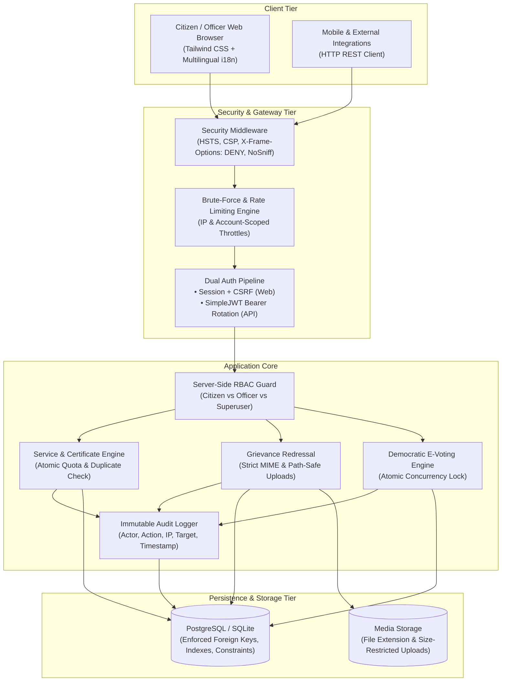

<div align="center">
  <h1>🏛️ Digital Gram Panchayath (Secure Enterprise Edition)</h1>
  <p>A Production-Grade, Hardened E-Governance & Grievance Redressal Portal for Local Administrations.</p>

  [](https://www.djangoproject.com/)
  [](https://www.django-rest-framework.org/)
  [](https://django-rest-framework-simplejwt.readthedocs.io/)
  [](https://owasp.org/)
  [](https://docs.djangoproject.com/en/5.2/topics/testing/)
  [](https://www.python.org/)
</div>

---

## 📑 Table of Contents
1. [Architectural Overview](#-architectural-overview)
2. [Threat Model & Security Posture](#-threat-model--security-posture)
3. [Authentication & Authorization Strategy](#-authentication--authorization-strategy)
4. [Security Controls & Vulnerability Remediations](#-security-controls--vulnerability-remediations)
5. [REST API & JWT Specification](#-rest-api--jwt-specification)
6. [Technology Stack](#-technology-stack)
7. [Installation & Quick Start](#-installation--quick-start)
8. [Automated Test Suite & Verification](#-automated-test-suite--verification)
9. [Deployment & Production Checklist](#-deployment--production-checklist)
10. [Remaining Deployment Dependencies & Limitations](#-remaining-deployment-dependencies--limitations)

---

## 🏛️ Architectural Overview

Digital Gram Panchayath is an enterprise-oriented digital government portal built with a **defense-in-depth architecture**. It combines a responsive server-rendered interface (with multilingual support in English, Kannada, and Hindi) with a decoupled REST API secured by JWT authentication.



---

## 🛡️ Threat Model & Security Posture

### Assets
- **Citizen PII**: Aadhar numbers, full names, physical addresses, contact information.
- **Official Records**: Benefit scheme applications, rejection reasons, grievance evidence.
- **Electoral Integrity**: Ballots cast, candidate registrations, election winners.
- **System Credibility**: Officer credentials, audit logs, administrative capabilities.

### Threat Actors
1. **Unauthenticated Public Users**: Opportunistic credential stuffers, automated crawlers, malicious file uploaders.
2. **Authenticated Citizens**: Attempting horizontal privilege escalation (IDOR/BOLA) to inspect or tamper with another citizen's records.
3. **Malicious Insiders / Self-Registration Escalation**: Attempting to inject `is_staff` or `is_superuser` during public account creation.

### Threat Matrix & Mitigations (STRIDE Grounded)

| STRIDE Threat | Attack Vector | Project Remediation |
| :--- | :--- | :--- |
| **Spoofing** | Credential stuffing & brute-force login attempts | Memory/cache-based login throttling (5 failed attempts locks out for 5 minutes). Secure password complexity enforcement. |
| **Tampering** | Parameter manipulation & mass assignment during registration | Strict ModelForms & DRF Serializers excluding privileged flags (`is_staff`, `is_superuser`, groups). Server-side status transition validations. |
| **Repudiation** | Denying administrative actions (e.g. rejection/approval of schemes) | Centralized `AuditLog` recording user, action, target entity, IP address, and timestamp for all sensitive mutations. |
| **Information Disclosure** | IDOR / BOLA viewing another citizen's profile or complaints | Server-side QuerySet filtering (`filter(user=request.user)`) and object-level permission enforcement in both Django views and DRF ViewSets. |
| **Denial of Service** | Unrestricted file uploads (e.g., multi-gigabyte or zip bombs) | Attachment validator restricting size to ≤ 5MB and allowing only whitelisted extensions (`.pdf`, `.png`, `.jpg`, `.jpeg`). |
| **Elevation of Privilege** | Normal citizen accessing officer dashboards or modifying services | `@officer_required` decorator and `IsOfficerOrAdmin` permission returning explicit HTTP 403 Forbidden with audit logging. |

---

## 🔐 Authentication & Authorization Strategy

### 1. Why Dual Authentication (Session vs. JWT)?
* **Session Authentication with CSRF Protection**: Used for server-rendered Django templates (`/user-dashboard/`, `/officer-dashboard/`, `/services/`). Django sessions are `HttpOnly` and `SameSite='Lax'`, making them inherently immune to client-side XSS token theft.
* **JSON Web Tokens (JWT) via SimpleJWT**: Used for REST API consumers (`/api/v1/`). Tokens are decoupled, stateless, and implement:
  - Short-lived Access Tokens (15-minute validity).
  - Refresh-Token Rotation (each refresh yields a new refresh token).
  - Refresh-Token Blacklisting on Logout (`/api/v1/auth/logout/`).

### 2. Google OAuth 2.0 Architecture
To integrate Google OAuth 2.0 in production environments:
1. Register OAuth credentials in the [Google Cloud Console](https://console.cloud.google.com/apis/credentials).
2. Configure Authorized Redirect URIs: `https://<domain>/accounts/google/login/callback/`.
3. Set environment variables:
   ```env
   GOOGLE_OAUTH_CLIENT_ID=your-client-id.apps.googleusercontent.com
   GOOGLE_OAUTH_CLIENT_SECRET=your-client-secret
   ```
4. Never commit client secrets to version control. The application reads OAuth configuration dynamically from the environment.

### 3. Server-Side Role-Based Access Control (RBAC)
* **Citizen**: Authenticated user (`is_staff=False`, `is_superuser=False`). Can only view/manage their own applications, file complaints, and vote.
* **Officer / Administrator**: Privileged staff (`is_staff=True` or `is_superuser=True`). Can manage service schemas, review applications, resolve complaints, and administer elections.

---

## 🔍 Security Controls & Vulnerability Remediations

1. **Zero Committed Secrets**:
   - Removed all hardcoded database credentials and fallback secret keys.
   - Dynamic environment configuration via `python-dotenv` with local SQLite fallback for seamless developer onboarding and offline testing.
2. **IDOR & BOLA Fixes**:
   - `core.views.profile`: Citizens attempting to inspect other users via `/profile/<username>/` are blocked with HTTP 403 Forbidden.
   - `core.views.view_applications` & `core.views.delete_complaint`: Enforce strict ownership or officer rights.
   - `ApplicationViewSet` & `ComplaintViewSet`: Base querysets filter strictly by `request.user` for non-staff.
3. **Malicious File Upload Restrictions**:
   - Uploaded complaint attachments are validated against a strict whitelist (`.pdf`, `.jpg`, `.jpeg`, `.png`).
   - File size ceiling enforced at 5MB (`MAX_UPLOAD_SIZE`).
4. **Race Condition & Double-Voting Prevention**:
   - Voting transactions use `transaction.atomic()` with session validation, ensuring each citizen can cast exactly one vote per session.
   - Duplicate service applications are prevented atomically before quota increments.
5. **Production Security Headers**:
   - `X-Frame-Options: DENY` (prevents clickjacking).
   - `SECURE_CONTENT_TYPE_NOSNIFF: True` (prevents MIME-sniffing).
   - `SECURE_BROWSER_XSS_FILTER: True`.
   - `SESSION_COOKIE_HTTPONLY: True` & `SESSION_COOKIE_SAMESITE: Lax`.
   - `python manage.py check --deploy` passes with **0 issues**.

---

## 📡 REST API & JWT Specification

Base URL: `/api/v1/`

| Endpoint | Method | Auth Required | Description |
| :--- | :---: | :---: | :--- |
| `auth/register/` | `POST` | Public | Register new citizen (role escalation prevented) |
| `auth/token/` | `POST` | Public | Obtain JWT Access (15m) & Refresh (24h) token pair |
| `auth/token/refresh/`| `POST` | Public | Rotate refresh token and obtain new access token |
| `auth/token/verify/` | `POST` | Public | Validate JWT signature and lifetime |
| `auth/logout/` | `POST` | Bearer Token | Blacklist refresh token & revoke session |
| `profile/` | `GET`, `PUT` | Bearer Token | Retrieve or update authenticated citizen profile |
| `services/` | `GET` | Bearer Token | List all available Gram Panchayat schemes |
| `services/` | `POST` | Officer Only | Create new government service |
| `applications/` | `GET`, `POST`| Bearer Token | List own applications (officer sees all) / submit application |
| `applications/{id}/review/` | `POST` | Officer Only | Approve or reject citizen application |
| `complaints/` | `GET`, `POST`| Bearer Token | List own grievances / submit complaint with attachment |
| `complaints/{id}/review/` | `POST` | Officer Only | Transition complaint status (`in_progress`, `resolved`) |
| `voting-sessions/` | `GET` | Bearer Token | List election sessions and candidates |
| `voting-sessions/{id}/vote/`| `POST` | Bearer Token | Concurrency-safe ballot submission |

---

## 🛠️ Technology Stack

- **Framework**: Django 5.2 / Django 6.1 (with DRF compatibility shim)
- **API Engine**: Django REST Framework 3.16+, SimpleJWT 5.5+
- **Database**: PostgreSQL (Production) / SQLite (Development & Automated CI)
- **Static Assets**: WhiteNoise 6.11 (Compressed Manifest Storage)
- **Styling**: Tailwind CSS (Dark Mode & Accessible Typography)
- **Internationalization**: Full localization support (English, हिन्दी, ಕನ್ನಡ)

---

## 🚀 Installation & Quick Start

### 1. Clone & Switch to Feature Branch
```bash
git clone https://github.com/gowdaanup73-pixel/Digital-Gram-Panchayath.git
cd Digital-Gram-Panchayath
git checkout feature/secure-architecture
```

### 2. Environment Setup
```bash
python -m venv venv
# On Windows:
venv\Scripts\activate
# On Linux/macOS:
source venv/bin/activate

pip install -r requirements.txt
```

### 3. Configure Environment Variables
Copy the provided `.env.example` to `.env`:
```bash
cp .env.example .env
```
*(In local development, leaving `DATABASE_URL` empty automatically defaults to local SQLite without requiring external credentials).*

### 4. Apply Migrations
```bash
python manage.py migrate
```

### 5. Create Officer / Admin Account
```bash
python manage.py createsuperuser
```

### 6. Run Local Development Server
```bash
python manage.py runserver
```
- Citizen Portal: `http://127.0.0.1:8000/login/`
- Officer Portal: `http://127.0.0.1:8000/officer-login/`
- REST API Root: `http://127.0.0.1:8000/api/v1/`

---

## 🧪 Automated Test Suite & Verification

The repository includes a dedicated automated test suite in `core/tests.py` covering authentication, role boundaries, IDOR prevention, file restrictions, and JWT lifecycles:

```bash
python manage.py test
```

### Test Suite Execution Output
```text
Creating test database for alias 'default'...
...........................
----------------------------------------------------------------------
Ran 27 tests in 27.030s

OK
Destroying test database for alias 'default'...
Found 27 test(s).
System check identified no issues (0 silenced).
```

### Verify Deployment Configuration
```bash
# Verify standard system checks:
python manage.py check

# Verify production deployment readiness:
python manage.py check --deploy
```

---

## 📋 Deployment & Production Checklist

1. [ ] **Environment Variables**: Configure unique `SECRET_KEY`, `DEBUG=False`, and set explicit `ALLOWED_HOSTS`.
2. [ ] **Database**: Provide managed PostgreSQL URI via `DATABASE_URL` with SSL enabled (`sslmode=require`).
3. [ ] **Static Assets**: Run `python manage.py collectstatic --no-input`.
4. [ ] **HTTPS / Reverse Proxy**: Ensure SSL termination (e.g. Nginx, Cloudflare, Render, AWS ALB) passes `HTTP_X_FORWARDED_PROTO=https`.
5. [ ] **CORS / API Clients**: If hosting the frontend on a separate domain, configure `django-cors-headers` origins.

---

## ⚠️ Remaining Deployment Dependencies & Limitations

1. **Email Backend for Password Reset**:
   - The password reset routes are fully configured with security tokens. In production, configure SMTP credentials (`EMAIL_HOST`, `EMAIL_HOST_USER`, `EMAIL_HOST_PASSWORD`) in `.env` to route reset emails via an enterprise gateway (AWS SES, SendGrid, etc.).
2. **Reverse Proxy Rate Limiting**:
   - Application-level throttling is implemented via Django cache. For volumetric DDoS defense, pair with edge rate limiting (Cloudflare, AWS WAF, or Nginx `limit_req_zone`).
3. **Database Migration Sync**:
   - Always run `python manage.py migrate` during the deployment build pipeline before web workers spin up.

---

## 📄 License
This project is licensed under the MIT License.
