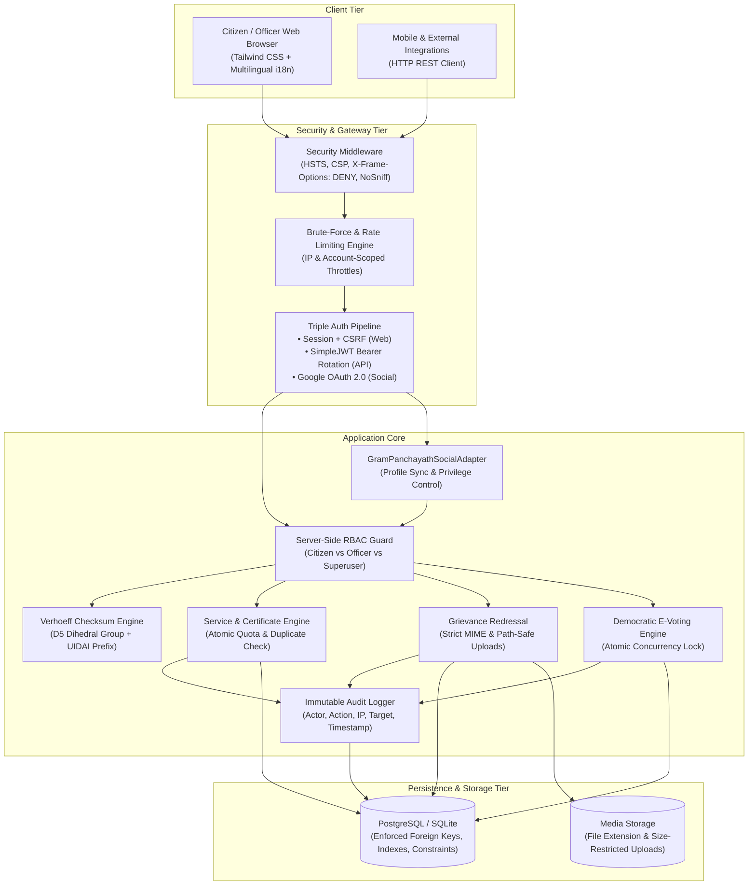

<div align="center">
  <h1>🏛️ Digital Gram Panchayath (Secure Enterprise Edition)</h1>
  <p>A Production-Grade, Hardened E-Governance & Grievance Redressal Portal for Local Administrations.</p>

  [](https://www.djangoproject.com/)
  [](https://www.django-rest-framework.org/)
  [](https://django-rest-framework-simplejwt.readthedocs.io/)
  [](https://django-allauth.readthedocs.io/)
  [](https://en.wikipedia.org/wiki/Verhoeff_algorithm)
  [](https://owasp.org/)
  [](https://docs.djangoproject.com/en/5.2/topics/testing/)
  [](https://www.python.org/)
</div>

---

## 📑 Table of Contents
1. [Architectural Overview](#-architectural-overview)
2. [Threat Model & Security Posture](#-threat-model--security-posture)
3. [Authentication & Authorization Strategy](#-authentication--authorization-strategy)
   - [Session vs. JWT Architecture](#1-session-vs-jwt-dual-pipeline)
   - [Google OAuth 2.0 & Profile Synchronization](#2-google-oauth-20--profile-synchronization)
   - [Server-Side Role-Based Access Control](#3-server-side-role-based-access-control-rbac)
4. [Aadhaar Validation & Privacy Architecture](#-aadhaar-validation--privacy-architecture)
   - [Verhoeff Mathematical Checksum](#1-verhoeff-checksum-algorithm)
   - [UIDAI Validation Rules & Prefix Standards](#2-uidai-specification-rules)
   - [Data Privacy, Display Masking & IDOR Protections](#3-privacy-masking--log-protection)
5. [Civic UI Design System & Localization](#-civic-ui-design-system--localization)
6. [REST API & JWT Specification](#-rest-api--jwt-specification)
7. [Technology Stack](#-technology-stack)
8. [Installation & Quick Start](#-installation--quick-start)
9. [Automated Test Suite & Verification](#-automated-test-suite--verification)
10. [Secret Management & GitGuardian Compliance](#-secret-management--gitguardian-compliance)
11. [Deployment & Production Checklist](#-deployment--production-checklist)
12. [License](#-license)

---

## 🏛️ Architectural Overview

Digital Gram Panchayath is an enterprise-oriented digital governance portal built with a **defense-in-depth architecture**. It combines a responsive server-rendered interface designed with an authentic regional aesthetic (Khadi paper, Ink black, and Rust red) with a decoupled REST API secured by JWT authentication.



---

## 🛡️ Threat Model & Security Posture

### Assets
- **Citizen PII**: Aadhaar numbers, legal full names, physical residential addresses, contact numbers.
- **Official Records**: Scheme applications, officer approval/rejection audit logs, grievance evidence files.
- **Electoral Integrity**: Ballots cast, candidate registrations, tally states.
- **System Credibility**: Administrative accounts, cryptographic signing keys, audit logs.

### Threat Matrix & Mitigations (STRIDE Grounded)

| STRIDE Threat | Attack Vector | Project Remediation |
| :--- | :--- | :--- |
| **Spoofing** | Credential stuffing & brute-force login attempts | In-memory cache-based login throttling (5 failed attempts locks out for 5 minutes). Password complexity enforcement. |
| **Tampering** | Parameter manipulation & mass assignment during registration | Strict ModelForms & DRF Serializers excluding privileged flags (`is_staff`, `is_superuser`, groups). Server-side status transition validations. |
| **Repudiation** | Denying administrative actions (e.g. rejection/approval of schemes) | Centralized `AuditLog` recording user, action, target entity, IP address, and timestamp for all sensitive mutations. |
| **Information Disclosure** | IDOR / BOLA viewing another citizen's profile or complaints | Server-side QuerySet filtering (`filter(user=request.user)`) and object-level permission enforcement in both Django views and DRF ViewSets. |
| **Denial of Service** | Unrestricted file uploads (e.g., multi-gigabyte or executable bombs) | Attachment validator restricting size to ≤ 5MB and allowing only whitelisted extensions (`.pdf`, `.png`, `.jpg`, `.jpeg`). |
| **Elevation of Privilege** | Normal citizen accessing officer dashboards or modifying services | `@officer_required` decorator and `IsOfficerOrAdmin` permission returning explicit HTTP 403 Forbidden with audit logging. Social login adapter prevents privilege escalation. |

---

## 🔐 Authentication & Authorization Strategy

### 1. Session vs. JWT Dual Pipeline
* **Session Authentication with CSRF Protection**: Used for server-rendered Django templates (`/user-dashboard/`, `/officer-dashboard/`, `/services/`). Django session cookies are `HttpOnly` and `SameSite='Lax'`, making them inherently immune to client-side XSS token theft.
* **JSON Web Tokens (JWT) via SimpleJWT**: Used for REST API consumers (`/api/v1/`). Tokens are decoupled, stateless, and implement:
  - Short-lived Access Tokens (15-minute validity).
  - Refresh-Token Rotation (each refresh yields a brand-new refresh token).
  - Refresh-Token Blacklisting on Logout (`/api/v1/auth/logout/`).

### 2. Google OAuth 2.0 & Profile Synchronization
Integrated via `django-allauth` with custom adapter extensions:
- **Custom Adapter (`core/adapters.py`)**: `GramPanchayathSocialAccountAdapter` handles social logins:
  - **First-time Google Signup**: Automatically populates `user.first_name`, `user.last_name`, and `user.email` from verified Google profile token payload (`extra_data`).
  - **Account Safety**: Explicitly sets `user.is_staff = False` and `user.is_superuser = False`. Social signup can never grant administrative privileges.
  - **Profile Synchronization**: Automatically attaches a citizen `Profile` record via `get_or_create`.
  - **Preservation of Manual Edits**: For returning users, existing user names and profile fields are never overwritten.
  - **Zero Fabrication**: Fields not provided by Google (Aadhaar, phone, date of birth, address) are **never fabricated** or auto-filled.
- **Google Cloud Console Configuration**:
  - Authorized JavaScript Origins: `http://127.0.0.1:8000` (Local) / `https://<your-domain>` (Production)
  - Authorized Redirect URIs: `http://127.0.0.1:8000/accounts/google/login/callback/`
  - Scopes: `profile`, `email`
  - Environment variables:
    ```env
    GOOGLE_OAUTH_CLIENT_ID=your-google-oauth-client-id.apps.googleusercontent.com
    GOOGLE_OAUTH_CLIENT_SECRET=your-google-oauth-client-secret
    ```

### 3. Server-Side Role-Based Access Control (RBAC)
* **Citizen**: Authenticated user (`is_staff=False`, `is_superuser=False`). Can only view/manage their own applications, file complaints, and vote.
* **Officer / Administrator**: Privileged staff (`is_staff=True` or `is_superuser=True`). Can manage service schemas, review applications, resolve complaints, and administer elections.

---

## 🪪 Aadhaar Validation & Privacy Architecture

The portal adheres to strict privacy and validation standards for citizen identity numbers:

### 1. Verhoeff Checksum Algorithm
- Aadhaar numbers are validated using the **Verhoeff checksum algorithm** based on the dihedral group $D_5$ (multiplication table $d$, permutation table $p$, and inverse table $inv$).
- Implemented as a reusable Django validator (`core.validators.validate_verhoeff` and `validate_aadhar_number`).
- Correct check digits detect 100% of single-digit transcription errors and 100% of adjacent transposition errors.

### 2. UIDAI Specification Rules
- **Length**: Exactly 12 digits.
- **Prefix Rule**: UIDAI standard specifies that Aadhaar numbers must **not start with 0 or 1** (must start with digits 2–9).
- **Separators**: Spaces (`XXXX XXXX XXXX`) and hyphens (`XXXX-XXXX-XXXX`) are automatically normalized.
- **Trilingual Localized Error Messages**: Validation messages are returned with translations in English, Kannada (ಕನ್ನಡ), and Hindi (हिन्दी).
- **Optional Field**: Aadhaar is optional unless specifically required by a scheme application. Empty submissions are accepted cleanly.

### 3. Privacy, Masking & Log Protection
- **Display Masking**: The full 12 digits are **never displayed** in plain text in the UI after saving.
- **Template Filter**: Custom template filter `` and `{{ profile.aadhar_number|mask_aadhar_display }}` renders numbers as `XXXX-XXXX-1234`.
- **Form Placeholder Preservation**: When a citizen updates their profile, the form renders the masked placeholder (`XXXX-XXXX-1234`). When submitted unchanged, `ProfileUpdateForm.clean_aadhar_number` preserves the persisted value without re-validating the mask or exposing the raw digits.
- **Log Sanitation**: Aadhaar numbers are never logged, passed in URL query parameters, or echoed in validation error messages.

---

## 🎨 Civic UI Design System & Localization

- **Khadi-Paper Aesthetic**: Crafted using a distinctive, tactile civic design system:
  - **Khadi Paper Background**: `#FAF6EE` (Warm textured cream) / Dark mode `#1E1E19`
  - **Ink Black Typography**: `#1E1E19` / Dark mode `#FAF6EE`
  - **Rust Red Accent**: `#C84B31` (Government seal / terracotta accents)
  - **Stone Borders**: `#D8CDBB` / Dark mode `#3E3E34`
- **Typography**: Paired with modern serif headings (Merriweather / Outfit) and accessible sans-serif body typography.
- **Responsive Layout**: Designed mobile-first with accessible touch targets, ARIA labels, and keyboard navigation.
- **Multilingual Support**: Fully localized layouts and labels in English, Kannada (ಕನ್ನಡ), and Hindi (हिन्दी).

---

## 📡 REST API & JWT Specification

Base URL: `/api/v1/`

| Endpoint | Method | Auth Required | Description |
| :--- | :---: | :---: | :--- |
| `auth/register/` | `POST` | Public | Register new citizen (privilege escalation prevented) |
| `auth/token/` | `POST` | Public | Obtain JWT Access (15m) & Refresh (24h) token pair |
| `auth/token/refresh/`| `POST` | Public | Rotate refresh token and obtain new access token |
| `auth/token/verify/` | `POST` | Public | Validate JWT signature and lifetime |
| `auth/logout/` | `POST` | Bearer Token | Blacklist refresh token & revoke session |
| `profile/` | `GET`, `PUT` | Bearer Token | Retrieve or update authenticated citizen profile |
| `services/` | `GET` | Bearer Token | List all available Gram Panchayat schemes |
| `services/` | `POST` | Officer Only | Create new government service |
| `applications/` | `GET`, `POST`| Bearer Token | List own applications (officer sees all) / submit application |
| `applications/{id}/review/` | `POST` | Officer Only | Approve or reject citizen application |
| `complaints/` | `GET`, `POST`| Bearer Token | List own grievances / submit complaint with attachment |
| `complaints/{id}/review/` | `POST` | Officer Only | Transition complaint status (`in_progress`, `resolved`) |
| `voting-sessions/` | `GET` | Bearer Token | List election sessions and candidates |
| `voting-sessions/{id}/vote/`| `POST` | Bearer Token | Concurrency-safe ballot submission |

---

## 🛠️ Technology Stack

- **Framework**: Django 5.2 / Django 6.1
- **API Engine**: Django REST Framework 3.16+, SimpleJWT 5.5+
- **Authentication**: Session Auth, SimpleJWT, `django-allauth` (Google OAuth 2.0)
- **Database**: PostgreSQL (Production) / SQLite (Development & Testing)
- **Static Assets**: WhiteNoise 6.11 (Compressed Manifest Storage)
- **Styling**: Tailwind CSS (Khadi Paper Civic Palette & Dark Mode)
- **Validation**: Verhoeff Checksum Engine (Dihedral Group $D_5$)
- **Localization**: English, Kannada (ಕನ್ನಡ), Hindi (हिन्दी)

---

## 🚀 Installation & Quick Start

### 1. Clone & Switch to Feature Branch
```bash
git clone https://github.com/gowdaanup73-pixel/Digital-Gram-Panchayath.git
cd Digital-Gram-Panchayath
git checkout feature/secure-architecture
```

### 2. Environment Setup
```bash
python -m venv venv
# On Windows:
venv\Scripts\activate
# On Linux/macOS:
source venv/bin/activate

pip install -r requirements.txt
```

### 3. Configure Environment Variables
Copy `.env.example` to `.env`:
```bash
cp .env.example .env
```
*(In local development, leaving `DATABASE_URL` unset automatically defaults to local SQLite without requiring external credentials).*

### 4. Apply Migrations
```bash
python manage.py migrate
```

### 5. Create Officer / Administrator Account
```bash
python manage.py createsuperuser
```

### 6. Run Local Development Server
```bash
python manage.py runserver
```
- **Citizen Portal**: `http://127.0.0.1:8000/login/`
- **Officer Portal**: `http://127.0.0.1:8000/officer-login/`
- **REST API Root**: `http://127.0.0.1:8000/api/v1/`

---

## 🧪 Automated Test Suite & Verification

The project includes **56 automated unit and integration tests** in `core/tests.py`:

```bash
python manage.py test --verbosity=2
```

### Test Coverage Highlights:
- **`GoogleOAuthAdapterTests` (8 tests)**: Google signup profile autofill, returning user data preservation, privilege escalation prevention (`is_staff`/`is_superuser` blocked), login/register buttons, and OAuth redirection.
- **`AadhaarChecksumValidationTests` (8 tests)**: Verhoeff algorithm test vectors, checksum failure rejection, 0/1 prefix rejection, non-digit rejection, length validation, trilingual error messages, and non-exposure in exceptions.
- **`AadhaarPrivacyTests` (6 tests)**: Form initial value masking, masked placeholder submission preservation, profile view raw digit non-exposure, and template filter masking.
- **`SecurityAuthenticationTests` (8 tests)**: Registration privilege escalation prevention, weak password rejection, citizen/officer authentication separation, and brute-force throttling lockout.
- **`AuthorizationAndIDORTests` (9 tests)**: Cross-citizen profile protection, complaint deletion ownership checks, application approval/rejection permissions, and officer dashboard access boundaries.
- **`FileUploadAndSecurityValidationTests` (3 tests)**: Executable extension rejection, valid PDF acceptance, and double-voting race condition prevention.
- **`RestApiAndJwtTests` (7 tests)**: SimpleJWT token creation, token rotation, token blacklisting on logout, API IDOR protection, and officer-only review permissions.
- **`OAuthAndPasswordResetTests` (7 tests)**: Full password reset lifecycle, referer token leakage protection, and privacy-preserving non-disclosing email lookups.

### Test Execution Output:
```text
Ran 56 tests in 28.286s

OK
Destroying test database for alias 'default'...
Found 56 test(s).
System check identified no issues (0 silenced).
```

---

## 🔒 Secret Management & GitGuardian Compliance

- **Zero Hardcoded Secrets**: All production secrets, database credentials, and OAuth credentials are read strictly from environment variables (`os.environ`).
- **Dynamic Test Credentials**: Unit tests use dynamically generated runtime fixtures (`secrets.token_hex`), preventing static scanners from detecting literal credentials in test code.
- **Repository `.gitignore`**: Explicitly ignores `.env`, `client_secret*.json`, `*.pem`, `*.key`, `db.sqlite3`, `media/`, and `*.log`.

---

## 📋 Deployment & Production Checklist

1. [ ] **Environment Variables**: Configure unique `SECRET_KEY`, `DEBUG=False`, and set explicit `ALLOWED_HOSTS`.
2. [ ] **Database**: Provide managed PostgreSQL connection URI via `DATABASE_URL` with SSL enabled (`sslmode=require`).
3. [ ] **Google OAuth Credentials**: Set `GOOGLE_OAUTH_CLIENT_ID` and `GOOGLE_OAUTH_CLIENT_SECRET`.
4. [ ] **Static Assets**: Execute `python manage.py collectstatic --no-input`.
5. [ ] **HTTPS / Proxy**: Ensure reverse proxy terminates TLS and forwards `HTTP_X_FORWARDED_PROTO=https`.
6. [ ] **Email Gateway**: Configure SMTP credentials (`EMAIL_HOST`, `EMAIL_HOST_USER`, `EMAIL_HOST_PASSWORD`) for password reset delivery.

---

## 📄 License
This project is licensed under the MIT License.
